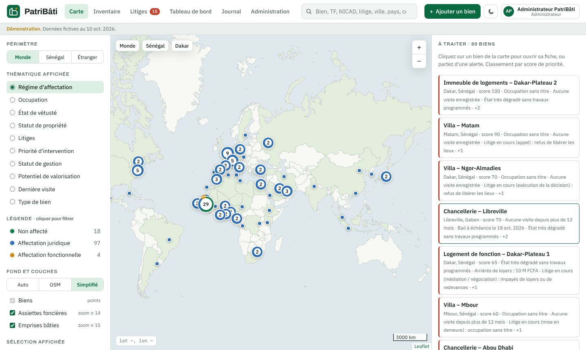
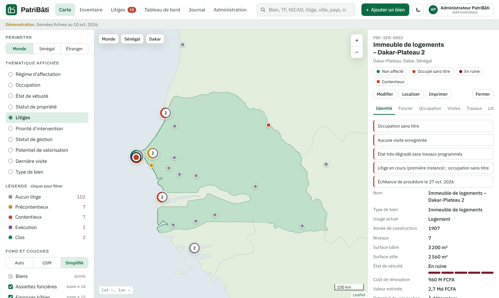
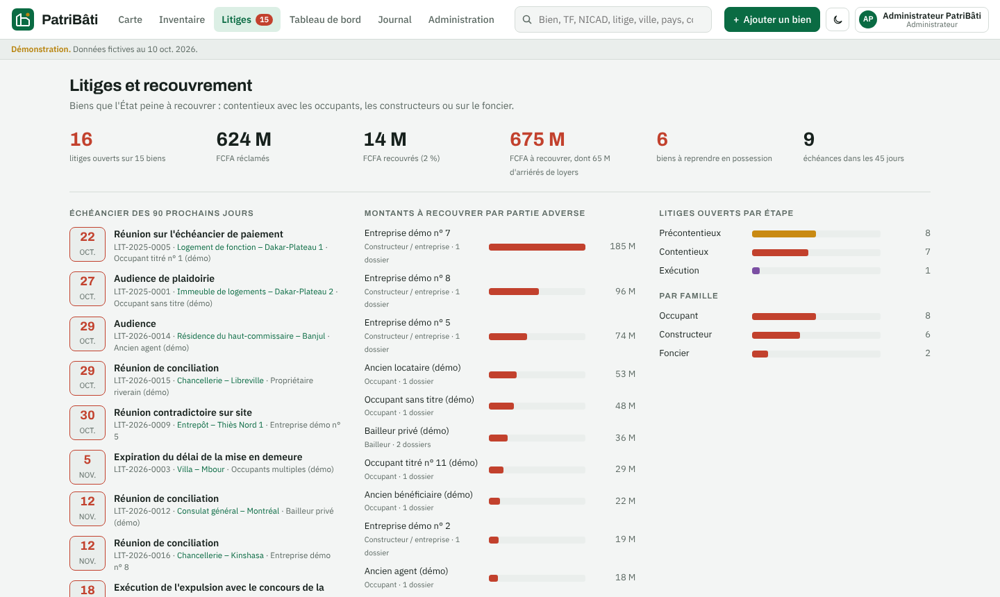
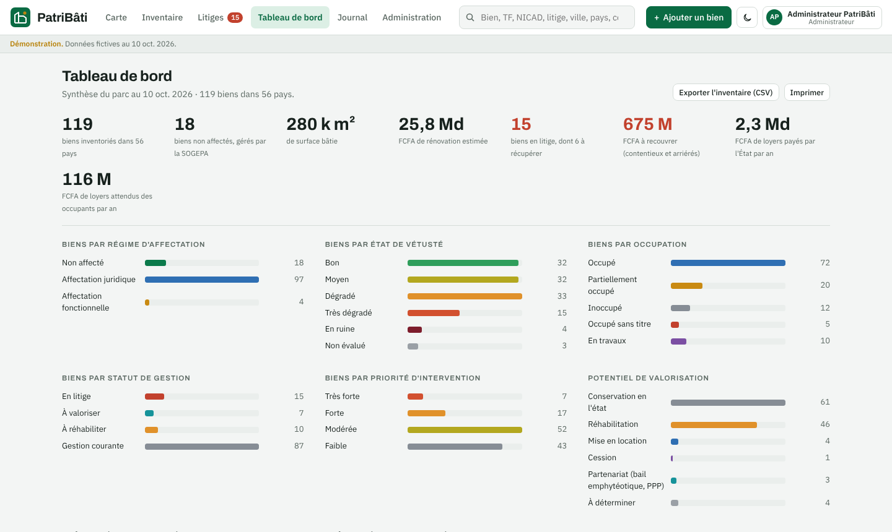
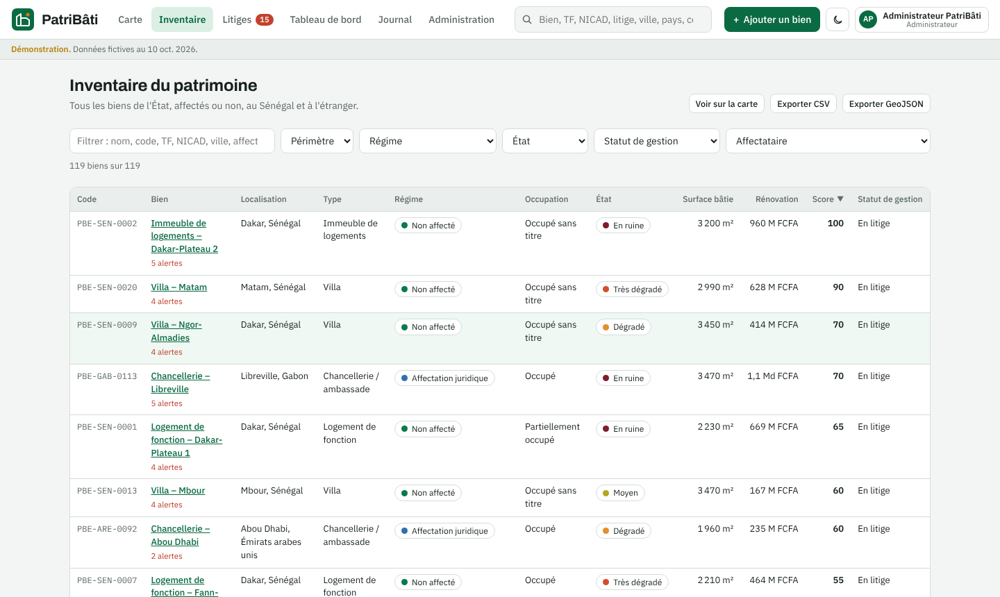
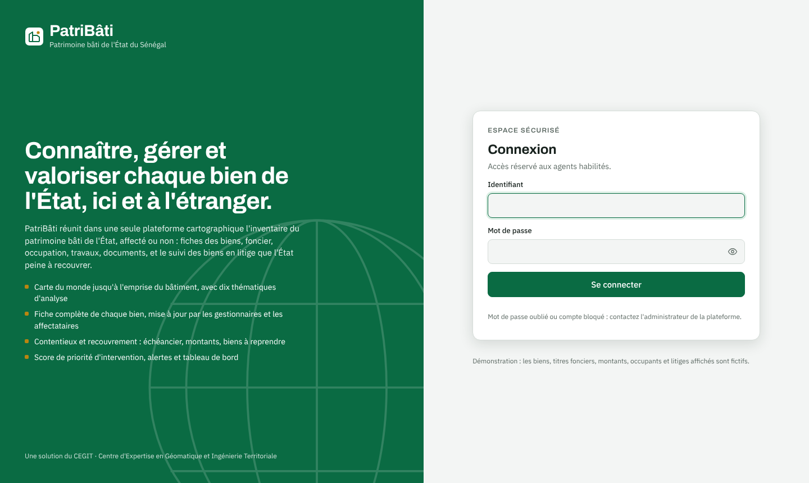
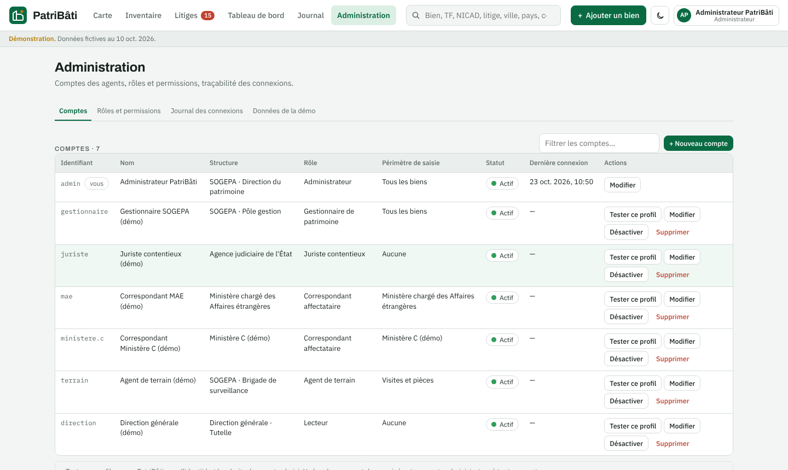
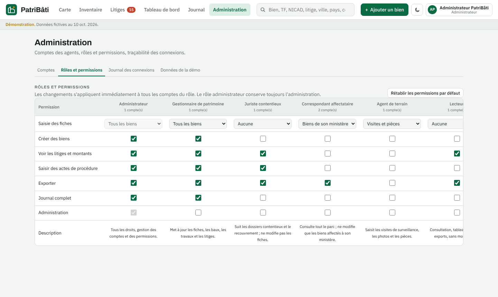
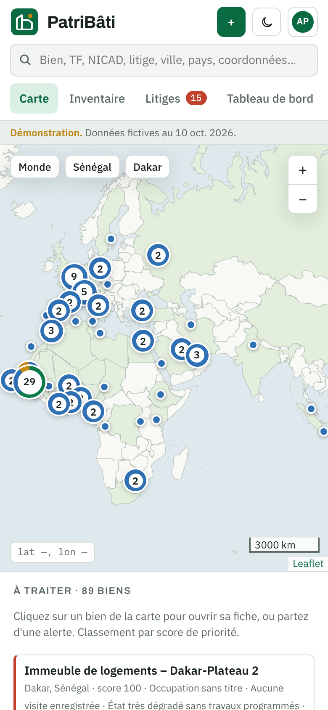

<p align="center"></p>

# PatriBâti

**Le patrimoine bâti de l'État du Sénégal, cartographié, suivi et valorisé.**
PatriBâti est une plateforme cartographique conçue par le **CEGIT** (Centre d'Expertise en Géomatique et Ingénierie Territoriale) pour inventorier et gérer l'intégralité du patrimoine bâti de l'État, affecté comme non affecté, au Sénégal et à l'étranger. Elle s'adresse en premier lieu à la société de gestion du patrimoine bâti de l'État (SOGEPA), aux ministères affectataires et aux services chargés du contentieux.

> **Démo en ligne : https://bathie18.github.io/patribati/**
> Prototype fonctionnel. **Toutes les données sont fictives** : biens, titres fonciers, NICAD, montants, occupants, entreprises et litiges ont été générés pour la démonstration. Les localisations sont approximatives et les emprises sont des formes schématiques.



---

## Sommaire

- [Accès à la démonstration](#accès-à-la-démonstration)
- [Fonctionnalités](#fonctionnalités)
- [Pile technique 100 % open source](#pile-technique-100--open-source)
- [Structure du dépôt](#structure-du-dépôt)
- [Lancer le prototype en local](#lancer-le-prototype-en-local)
- [Publier sur GitHub Pages](#publier-sur-github-pages)
- [Documentation](#documentation)
- [Sources et licences](#sources-et-licences)

## Accès à la démonstration

L'application s'ouvre sur un écran de **connexion**. Les comptes de démonstration ci-dessous ne sont pas affichés à l'écran : ils sont listés ici.

| Identifiant | Mot de passe | Rôle | Ce qu'il peut faire |
|---|---|---|---|
| `admin` | `admin` | Administrateur | Tout, plus le module **Administration** : comptes, rôles et permissions, test des autres profils |
| `gestionnaire` | `Gestion2026` | Gestionnaire de patrimoine | Met à jour les fiches, les baux, les travaux et les litiges ; crée des biens |
| `juriste` | `Juriste2026` | Juriste contentieux | Suit les litiges et saisit les actes de procédure ; ne modifie pas les fiches |
| `mae` | `Mae2026` | Correspondant affectataire | Ministère chargé des Affaires étrangères : ne modifie que ses biens (ambassades, consulats…) ; pas d'accès aux montants contentieux |
| `ministere.c` | `MinC2026` | Correspondant affectataire | Même rôle, pour un autre ministère (fictif) |
| `terrain` | `Terrain2026` | Agent de terrain | Saisit les visites de surveillance, les photos et les pièces |
| `direction` | `Direction2026` | Lecteur | Consultation, tableau de bord, exports ; aucune modification |

Connecté avec `admin`, le module **Administration** permet de :

- créer, modifier, désactiver ou supprimer des comptes (identifiant, mot de passe, nom, structure, rôle, ministère pour un affectataire) ;
- régler les **permissions de chaque rôle** (saisie, création de biens, accès aux litiges, actes de procédure, exports, journal, administration) ;
- **tester n'importe quel profil** (« Tester ce profil ») : l'interface s'ouvre avec l'identité et les droits du compte choisi, un bandeau permet de revenir à son compte administrateur ;
- consulter le **journal des connexions** (connexions, échecs, tests de profil, modifications de comptes et de permissions) ;
- réinitialiser les saisies de la démonstration ou les comptes.

Le menu du compte, en haut à droite, donne accès à la déconnexion.
Comptes, permissions et saisies sont conservés **dans le navigateur** (stockage local) : ils survivent à un rechargement de la page et ne sont visibles que sur ce poste. L'authentification est **simulée** côté navigateur ; en production, elle repose sur Keycloak et les droits sont appliqués par l'API et par PostgreSQL (voir [Rôles et permissions](docs/roles-permissions.md)).

Liens directs utiles pour une présentation :

| Adresse | Ouvre |
|---|---|
| `…/patribati/#carte` | La carte |
| `…/patribati/#bien/2` | La fiche d'un bien précis (ici un immeuble en contentieux à Dakar-Plateau) |
| `…/patribati/#litiges` | Le module Litiges et recouvrement |
| `…/patribati/#tableau` | Le tableau de bord |

## Fonctionnalités

| Module | Ce que fait le prototype |
|---|---|
| **Carte** | Carte du monde (Leaflet) : chaque bien visible dès la vue monde, coloré selon la thématique, les biens proches regroupés dans un anneau aux couleurs de leurs catégories ; en zoomant, chaque bien, son **assiette foncière** et ses **emprises bâties**. Fond automatique (pays du monde, puis OpenStreetMap), OpenStreetMap seul ou fond simplifié hors ligne. **Dix thématiques** : régime d'affectation, occupation, état de vétusté, statut de propriété, litiges, priorité d'intervention, statut de gestion, potentiel de valorisation, dernière visite, type de bien. Légende cliquable pour filtrer, périmètre Monde / Sénégal / Étranger, indicateurs de la sélection. |
| **Fiche du bien** | Huit onglets : identité, foncier, occupation et baux, visites, travaux, litiges, documents, album photo. Alertes en tête de fiche. **Modification** selon le profil, **saisie d'une visite**, **ajout d'un acte de procédure**, **téléversement** de documents et de photos, impression de la fiche. |
| **Ajout d'un bien** | Clic sur la carte : le pays est détecté, un code est attribué, la fiche s'ouvre en saisie. |
| **Recherche** | Autocomplétion sur le nom, le code, le titre foncier, le NICAD, la commune, l'affectataire, la référence d'un litige, la ville, le pays, ou des coordonnées « lat, lon ». |
| **Inventaire** | Tableau de tous les biens, filtres (texte, périmètre, régime, état, statut de gestion, affectataire), tri par colonne, **exports CSV et GeoJSON**, bouton « Voir sur la carte ». |
| **Litiges et recouvrement** | Biens que l'État peine à recouvrer : indicateurs (réclamé, recouvré, à recouvrer, biens à reprendre), **échéancier des 90 jours**, montants par partie adverse, répartition par étape et par famille, liste filtrable des dossiers, arriérés de loyers. |
| **Tableau de bord** | Indicateurs clés, répartitions du parc, coût de rénovation par région ou pays, priorités d'intervention, patrimoine à l'étranger, suivi des travaux, inventaire par affectataire, alertes de gestion. |
| **Journal** | Traçabilité de chaque création, modification, visite, pièce et acte, avec l'auteur et la date ; export CSV. |
| **Administration** | Comptes, rôles et permissions modifiables, test des profils, journal des connexions, réinitialisation de la démo. |

Les règles de calcul (alertes, score de priorité, statut de gestion) sont décrites dans [docs/regles-metier.md](docs/regles-metier.md).

| Fiche d'un bien en contentieux | Litiges et recouvrement |
|---|---|
|  |  |
| **Tableau de bord** | **Inventaire** |
|  |  |
| **Connexion** | **Administration** |
|  |  |
| **Rôles et permissions** | **Version mobile** |
|  |  |

## Pile technique 100 % open source

| Couche | Prototype (ce dépôt) | Cible de production |
|---|---|---|
| Interface | HTML, CSS, JavaScript sans framework ni étape de compilation | Même base, découpée en modules (Vite) |
| Cartographie | [Leaflet](https://leafletjs.com) 1.9.4 (BSD-2), fonds OpenStreetMap (ODbL) et Natural Earth (domaine public) | Leaflet ou MapLibre GL, tuiles vectorielles [Martin](https://martin.maplibre.org), fonds auto-hébergés, orthophotos |
| Données | Fichiers statiques (GeoJSON, CSV, export JSON de la base) | PostgreSQL 16 + PostGIS 3 ([database/](database)) |
| API | — | [FastAPI](https://fastapi.tiangolo.com) (MIT) ou PostgREST (MIT), contrat OpenAPI 3 ([api/openapi.yaml](api/openapi.yaml)) |
| Identité et droits | Comptes et rôles simulés dans le navigateur | Keycloak (Apache-2.0, OpenID Connect) + PostgreSQL Row-Level Security |
| Documents et photos | Stockage local du navigateur | MinIO (AGPL-3.0), compatible S3 |
| Collecte terrain | Formulaire de visite dans la fiche | Application web hors ligne, ou ODK Collect / KoboToolbox pour les tournées de surveillance |
| Exploitation | GitHub Pages | Docker Compose, Nginx, sauvegardes pgBackRest, hébergement souverain |
| Polices | Archivo, IBM Plex Sans et Mono (SIL OFL), auto-hébergées | idem |

Toutes les bibliothèques sont **embarquées dans le dépôt** (`assets/vendor/`, `assets/fonts/`) : la page n'appelle aucun CDN. Seules les tuiles OpenStreetMap sont chargées à la demande, en vue rapprochée.

## Structure du dépôt

```
patribati/
├── index.html                  Point d'entrée de l'application (GitHub Pages)
├── assets/
│   ├── css/                    Feuilles de style (thèmes clair et sombre, mobile, impression)
│   ├── js/
│   │   ├── config.js           Rôles, permissions et comptes par défaut, modules, seuils de la carte
│   │   ├── core.js             Données, règles métier, thématiques, droits, persistance, journal
│   │   ├── auth.js             Comptes, connexion, session, test de profil
│   │   ├── map.js              Carte (Leaflet) : regroupements, assiettes, emprises, fonds
│   │   ├── fiche.js            Module Carte : thématiques, fiche du bien, saisies, ajout d'un bien
│   │   ├── views.js            Inventaire, Litiges et recouvrement, Tableau de bord, Journal
│   │   ├── admin.js            Administration : comptes, rôles et permissions, connexions
│   │   └── app.js              Connexion, bandeau, menu du compte, recherche, routage
│   ├── data/                   patribati-data.js (jeu de démonstration), monde.js (pays du monde)
│   ├── fonts/  img/  vendor/   Polices, logos et captures, bibliothèques tierces
├── data/                       Données ouvertes de la démo : GeoJSON, CSV, export JSON de la base
├── database/                   Scripts PostgreSQL / PostGIS de la base cible « patribati »
├── api/openapi.yaml            Contrat d'API REST cible
├── docs/                       Documentation fonctionnelle et technique
└── tools/                      Préparation des données de l'application
```

## Lancer le prototype en local

Toutes les données sont chargées par des balises `<script>` : un **double-clic sur `index.html`** suffit. On peut aussi passer par un petit serveur web :

```bash
git clone https://github.com/bathie18/patribati.git
cd patribati
python3 -m http.server 8000
# puis ouvrir http://localhost:8000
```

Pour régénérer les données de l'application après modification des fichiers de `data/` : `python3 tools/build_data.py`.
Le réseau diplomatique et consulaire de démonstration est produit par `python3 tools/generer_biens_etranger.py` (reproductible).
Pour les régénérer depuis une base PostGIS installée avec `database/` : `tools/exporter_depuis_postgis.sh`.

## Publier sur GitHub Pages

1. Créer le dépôt `patribati` sur le compte GitHub `bathie18` (public).
2. Y pousser le contenu de ce dossier (voir [docs/deploiement.md](docs/deploiement.md) pour les commandes, ou glisser-déposer les fichiers dans l'interface web de GitHub).
3. **Settings → Pages → Build and deployment** : *Deploy from a branch*, branche `main`, dossier `/ (root)`.
4. Après une à deux minutes, la démo est en ligne à l'adresse **https://bathie18.github.io/patribati/**.

Le fichier `.nojekyll` évite tout traitement Jekyll : le site est servi tel quel.

## Documentation

| Document | Contenu |
|---|---|
| [Guide utilisateur](docs/guide-utilisateur.md) | Parcours de démonstration et utilisation de chaque module |
| [Règles métier](docs/regles-metier.md) | Alertes, score de priorité, statut de gestion, thématiques |
| [Litiges et recouvrement](docs/litiges-recouvrement.md) | Modèle du dossier contentieux, phases, indicateurs |
| [Rôles et permissions](docs/roles-permissions.md) | Profils, matrice des droits, mise en œuvre en production |
| [Architecture](docs/architecture.md) | Architecture du prototype et architecture cible |
| [Modèle de données](docs/modele-donnees.md) | Tables, vues, nomenclatures et déclencheurs de la base PostGIS |
| [Déploiement](docs/deploiement.md) | GitHub Pages, puis serveur de production |
| [Feuille de route](docs/feuille-de-route.md) | Évolutions proposées |
| [Données de démonstration](data/README.md) | Contenu et format des fichiers ouverts |

## Sources et licences

- **Données métier** : entièrement fictives, générées pour la démonstration.
- **Pays du monde** : [Natural Earth](https://www.naturalearthdata.com) 1:50 m, domaine public, via [world-atlas](https://github.com/topojson/world-atlas) (ISC).
- **Fond OpenStreetMap** : © contributeurs OpenStreetMap, licence ODbL. Pour un usage en production, prévoir un serveur de tuiles propre (la politique d'usage des serveurs d'OpenStreetMap ne permet pas un trafic important).
- **Bibliothèques et polices** : voir [THIRD_PARTY_NOTICES.md](THIRD_PARTY_NOTICES.md).
- Le nom PatriBâti n'a pas fait l'objet d'une recherche d'antériorité.

© CEGIT — Centre d'Expertise en Géomatique et Ingénierie Territoriale · [cegitgroup.com](https://cegitgroup.com)
