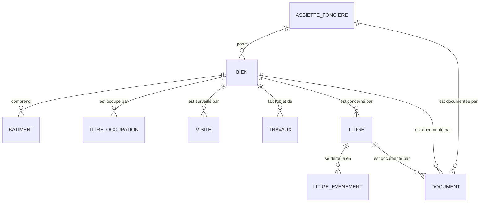

# Modèle de données

Ce document décrit la base cible de PatriBâti : PostgreSQL 16 + PostGIS 3, SRID 4326 (WGS 84). Les scripts de création sont dans [`database/`](../database). La démonstration en ligne n'utilise pas de base : elle lit un export de cette base (`data/patribati-base.json`, produit par la fonction `patrimoine.export_dashboard()`), transformé par [`tools/build_data.py`](../tools/build_data.py) en `assets/data/patribati-data.js`.

## Correspondance base → application

| Base (schéma `patrimoine`) | Application web (`window.PATRIBATI`) |
|---|---|
| `bien` + `v_bien_situation` | `biens[]` : identité, foncier, occupation, score, statut de gestion |
| `assiette_fonciere` | `assiettes` (GeoJSON, polygones) ; lien par `biens[].assietteCode` |
| `batiment` | `batiments` (GeoJSON, polygones) ; lien par `properties.bien` |
| `titre_occupation` | `biens[].baux[]` |
| `visite` | `biens[].visites[]` |
| `travaux` | `biens[].travaux[]` |
| `litige` + `litige_evenement` | `biens[].litiges[]` et `litiges[].evenements[]` |
| `document` | `biens[].docs[]` et `biens[].photos[]` |
| `journal` | Journal de la démo (stockage local du navigateur) |

## Schéma relationnel

Les nomenclatures du schéma `ref` (type de bien, régime, occupation, état de vétusté, type et phase de litige, etc.) sont référencées par leur libellé.

## Architecture fonctionnelle

| Mission (loi 2021-36) | Tables | Vues |
|---|---|---|
| Cartographier : quoi, où, quelle superficie | `assiette_fonciere`, `bien`, `batiment`, `document` | `v_bien_situation`, `v_synthese_pays`, `v_synthese_region`, `v_recherche` |
| Surveiller : occupation, état physique | `visite`, `titre_occupation` | `v_alertes` |
| Administrer : baux, travaux, contentieux | `titre_occupation`, `travaux`, `litige`, `litige_evenement` | `v_litige`, `v_recouvrement_loyers`, `v_suivi_travaux`, `v_inventaire_affectataire` |
| Valoriser et piloter | `bien.potentiel_valorisation`, `bien.valeur_estimee_fcfa` | `v_tableau_de_bord`, score de priorité dans `v_bien_situation`, fonction `export_dashboard()` |
| Tracer | `journal` | — |

## Tables

### ref.fond_pays

| Colonne | Type | Obligatoire | Valeur par défaut | Description |
|---|---|---|---|---|
| `id` | integer | oui | `nextval('fond_pays_id_seq'::regclass)` |  |
| `code_n3` | text |  |  |  |
| `iso3` | character(3) |  |  |  |
| `nom` | text |  |  |  |
| `nom_fr` | text |  |  |  |
| `geom` | geometry(MultiPolygon,4326) |  |  |  |

### patrimoine.assiette_fonciere

Terrain d'assiette : titre foncier, références cadastrales, superficie

| Colonne | Type | Obligatoire | Valeur par défaut | Description |
|---|---|---|---|---|
| `id` | integer | oui | `nextval('assiette_fonciere_id_seq'::regclass)` |  |
| `code` | text | oui |  |  |
| `nom` | text | oui |  |  |
| `pays_iso3` | character(3) | oui | `'SEN'::bpchar` |  |
| `pays` | text | oui | `'Sénégal'::text` |  |
| `region` | text |  |  |  |
| `departement` | text |  |  |  |
| `commune` | text |  |  |  |
| `ville` | text |  |  |  |
| `adresse` | text |  |  |  |
| `num_tf` | text |  |  | Numéro du titre foncier |
| `titulaire_tf` | text |  | `'État du Sénégal'::text` |  |
| `nicad` | text |  |  | Numéro d'identification cadastrale |
| `superficie_m2` | numeric(12,2) |  |  |  |
| `nature` | text | oui | `'Terrain bâti'::text` |  |
| `observations` | text |  |  |  |
| `geom` | geometry(MultiPolygon,4326) |  |  |  |
| `cree_le` | timestamp with time zone | oui | `now()` |  |
| `maj_le` | timestamp with time zone | oui | `now()` |  |
| `maj_par` | text |  | `CURRENT_USER` |  |

### patrimoine.batiment

Emprise au sol de chaque bâtiment d'un bien

| Colonne | Type | Obligatoire | Valeur par défaut | Description |
|---|---|---|---|---|
| `id` | integer | oui | `nextval('batiment_id_seq'::regclass)` |  |
| `bien_id` | integer | oui |  | → `patrimoine.bien` |
| `nom` | text |  |  |  |
| `nb_niveaux` | integer |  |  |  |
| `emprise_m2` | numeric(12,2) |  |  |  |
| `geom` | geometry(MultiPolygon,4326) | oui |  |  |

### patrimoine.bien

Bien du patrimoine bâti de l'État (bâtiment, ensemble bâti ou terrain nu), au Sénégal ou à l'étranger

| Colonne | Type | Obligatoire | Valeur par défaut | Description |
|---|---|---|---|---|
| `id` | integer | oui | `nextval('bien_id_seq'::regclass)` |  |
| `code` | text |  |  |  |
| `nom` | text | oui |  |  |
| `assiette_id` | integer |  |  | → `patrimoine.assiette_fonciere` |
| `type_bien` | text | oui |  | → `ref.type_bien` |
| `statut_propriete` | text | oui | `'Propriété de l''État'::text` | → `ref.statut_propriete` |
| `regime` | text | oui | `'Non affecté'::text` | Non affecté = géré par la SOGEPA ; affectation juridique ou fonctionnelle = entretien à la charge de l'affectataire → `ref.regime` |
| `affectataire` | text |  |  |  |
| `occupation` | text | oui | `'Inoccupé'::text` | → `ref.occupation` |
| `usage_actuel` | text |  |  |  |
| `effectif_agents` | integer |  |  | Nombre d'agents hébergés (ratio m² par agent) |
| `pays_iso3` | character(3) | oui | `'SEN'::bpchar` |  |
| `pays` | text | oui | `'Sénégal'::text` |  |
| `region` | text |  |  |  |
| `commune` | text |  |  |  |
| `ville` | text |  |  |  |
| `adresse` | text |  |  |  |
| `annee_construction` | integer |  |  |  |
| `nb_niveaux` | integer |  |  |  |
| `surface_batie_m2` | numeric(12,2) |  |  |  |
| `surface_utile_m2` | numeric(12,2) |  |  |  |
| `etat_vetuste` | text | oui | `'Non évalué'::text` | → `ref.etat_vetuste` |
| `cout_renov_fcfa` | bigint |  |  |  |
| `valeur_estimee_fcfa` | bigint |  |  |  |
| `potentiel_valorisation` | text | oui | `'À déterminer'::text` | Orientation proposée pour la valorisation du bien → `ref.potentiel_valorisation` |
| `date_derniere_visite` | date |  |  |  |
| `observations` | text |  |  |  |
| `geom` | geometry(Point,4326) |  |  |  |
| `cree_le` | timestamp with time zone | oui | `now()` |  |
| `maj_le` | timestamp with time zone | oui | `now()` |  |
| `maj_par` | text |  | `CURRENT_USER` |  |

### patrimoine.document

Fonds documentaire et album photo, rattachés à un bien, une assiette ou un litige

| Colonne | Type | Obligatoire | Valeur par défaut | Description |
|---|---|---|---|---|
| `id` | integer | oui | `nextval('document_id_seq'::regclass)` |  |
| `bien_id` | integer |  |  | → `patrimoine.bien` |
| `assiette_id` | integer |  |  | → `patrimoine.assiette_fonciere` |
| `litige_id` | integer |  |  | → `patrimoine.litige` |
| `categorie` | text | oui |  | → `ref.categorie_document` |
| `titre` | text | oui |  |  |
| `chemin` | text | oui |  |  |
| `date_doc` | date |  |  |  |
| `ajoute_par` | text |  | `CURRENT_USER` |  |
| `ajoute_le` | timestamp with time zone | oui | `now()` |  |

### patrimoine.journal

Journal d'audit : qui a modifié quoi et quand

| Colonne | Type | Obligatoire | Valeur par défaut | Description |
|---|---|---|---|---|
| `id` | bigint | oui | `nextval('journal_id_seq'::regclass)` |  |
| `horodatage` | timestamp with time zone | oui | `now()` |  |
| `utilisateur` | text | oui | `SESSION_USER` |  |
| `table_nom` | text | oui |  |  |
| `operation` | text | oui |  |  |
| `enregistrement_id` | integer |  |  |  |
| `avant` | jsonb |  |  |  |
| `apres` | jsonb |  |  |  |

### patrimoine.litige

Dossier de litige entre l'État et un occupant, un constructeur ou un tiers

| Colonne | Type | Obligatoire | Valeur par défaut | Description |
|---|---|---|---|---|
| `id` | integer | oui | `nextval('litige_id_seq'::regclass)` |  |
| `bien_id` | integer | oui |  | → `patrimoine.bien` |
| `reference` | text |  |  |  |
| `objet` | text | oui |  |  |
| `type_litige` | text | oui |  | → `ref.type_litige` |
| `partie_adverse_type` | text | oui |  | → `ref.partie_adverse_type` |
| `partie_adverse` | text |  |  |  |
| `date_ouverture` | date | oui | `CURRENT_DATE` |  |
| `phase` | text | oui | `'Mise en demeure'::text` | → `ref.phase_litige` |
| `juridiction` | text |  |  |  |
| `service_en_charge` | text |  |  |  |
| `prochaine_echeance` | date |  |  |  |
| `objet_echeance` | text |  |  |  |
| `montant_reclame_fcfa` | bigint | oui | `0` | Somme réclamée par l'État (arriérés, indemnités, pénalités, reprise de malfaçons) |
| `montant_recouvre_fcfa` | bigint | oui | `0` |  |
| `niveau_risque` | text | oui | `'Moyen'::text` | → `ref.niveau_risque` |
| `bien_a_recuperer` | boolean | oui | `false` | Vrai si l'enjeu est la reprise de possession du bien |
| `bien_recupere` | boolean | oui | `false` |  |
| `issue` | text |  |  |  |
| `date_cloture` | date |  |  |  |
| `observations` | text |  |  |  |
| `cree_le` | timestamp with time zone | oui | `now()` |  |
| `maj_le` | timestamp with time zone | oui | `now()` |  |
| `maj_par` | text |  | `CURRENT_USER` |  |

### patrimoine.litige_evenement

Chronologie de la procédure

| Colonne | Type | Obligatoire | Valeur par défaut | Description |
|---|---|---|---|---|
| `id` | integer | oui | `nextval('litige_evenement_id_seq'::regclass)` |  |
| `litige_id` | integer | oui |  | → `patrimoine.litige` |
| `date_evenement` | date | oui | `CURRENT_DATE` |  |
| `type_evenement` | text | oui |  | → `ref.type_evenement` |
| `description` | text |  |  |  |

### patrimoine.titre_occupation

Baux et conventions : l'État bailleur (recettes) ou preneur (loyers payés)

| Colonne | Type | Obligatoire | Valeur par défaut | Description |
|---|---|---|---|---|
| `id` | integer | oui | `nextval('titre_occupation_id_seq'::regclass)` |  |
| `bien_id` | integer | oui |  | → `patrimoine.bien` |
| `sens` | text | oui |  |  |
| `type_titre` | text | oui |  | → `ref.type_titre` |
| `occupant` | text |  |  |  |
| `reference_acte` | text |  |  |  |
| `date_debut` | date |  |  |  |
| `date_fin` | date |  |  |  |
| `loyer_mensuel_fcfa` | bigint |  |  |  |
| `arrieres_fcfa` | bigint | oui | `0` | Loyers ou redevances échus et non payés |
| `date_dernier_paiement` | date |  |  |  |
| `observations` | text |  |  |  |

### patrimoine.travaux

| Colonne | Type | Obligatoire | Valeur par défaut | Description |
|---|---|---|---|---|
| `id` | integer | oui | `nextval('travaux_id_seq'::regclass)` |  |
| `bien_id` | integer | oui |  | → `patrimoine.bien` |
| `type_travaux` | text | oui |  | → `ref.type_travaux` |
| `statut` | text | oui | `'Programmé'::text` | → `ref.statut_travaux` |
| `date_debut` | date |  |  |  |
| `date_fin` | date |  |  |  |
| `avancement_pct` | integer | oui | `0` |  |
| `entreprise` | text |  |  |  |
| `cout_fcfa` | bigint |  |  |  |
| `observations` | text |  |  |  |

### patrimoine.visite

Visites de surveillance (saisie terrain) : état physique et conditions d'occupation

| Colonne | Type | Obligatoire | Valeur par défaut | Description |
|---|---|---|---|---|
| `id` | integer | oui | `nextval('visite_id_seq'::regclass)` |  |
| `bien_id` | integer | oui |  | → `patrimoine.bien` |
| `date_visite` | date | oui | `CURRENT_DATE` |  |
| `agent` | text |  |  |  |
| `etat_constate` | text |  |  | → `ref.etat_vetuste` |
| `occupation_constatee` | text |  |  | → `ref.occupation` |
| `occupation_conforme` | boolean |  |  |  |
| `observations` | text |  |  |  |

## Vues

### patrimoine.v_alertes

| Colonne | Type |
|---|---|
| `id` | integer |
| `bien_id` | integer |
| `code` | text |
| `nom` | text |
| `ville` | text |
| `pays` | text |
| `categorie` | text |
| `gravite` | integer |
| `alerte` | text |
| `geom` | geometry(Point,4326) |

### patrimoine.v_bien_situation

Fiche complète du bien et situation de gestion (litiges, arriérés, score de priorité)

| Colonne | Type |
|---|---|
| `id` | integer |
| `code` | text |
| `nom` | text |
| `type_bien` | text |
| `statut_propriete` | text |
| `regime` | text |
| `affectataire` | text |
| `responsable_entretien` | text |
| `occupation` | text |
| `usage_actuel` | text |
| `effectif_agents` | integer |
| `pays_iso3` | character(3) |
| `pays` | text |
| `region` | text |
| `commune` | text |
| `ville` | text |
| `adresse` | text |
| `annee_construction` | integer |
| `nb_niveaux` | integer |
| `surface_batie_m2` | numeric(12,2) |
| `surface_utile_m2` | numeric(12,2) |
| `m2_par_agent` | numeric |
| `etat_vetuste` | text |
| `note_vetuste` | smallint |
| `cout_renov_fcfa` | bigint |
| `valeur_estimee_fcfa` | bigint |
| `potentiel_valorisation` | text |
| `date_derniere_visite` | date |
| `assiette_code` | text |
| `num_tf` | text |
| `titulaire_tf` | text |
| `nicad` | text |
| `superficie_assiette_m2` | numeric(12,2) |
| `nb_litiges` | bigint |
| `nb_litiges_ouverts` | bigint |
| `en_litige` | boolean |
| `etape_litige` | text |
| `phase_litige` | text |
| `type_litige` | text |
| `risque_eleve` | boolean |
| `a_recuperer` | boolean |
| `montant_reclame_fcfa` | numeric |
| `montant_recouvre_fcfa` | numeric |
| `reste_a_recouvrer_fcfa` | numeric |
| `prochaine_echeance` | date |
| `arrieres_fcfa` | numeric |
| `loyer_percu_mensuel_fcfa` | numeric |
| `loyer_paye_mensuel_fcfa` | numeric |
| `prochaine_fin_bail` | date |
| `nb_photos` | bigint |
| `nb_documents` | bigint |
| `nb_travaux_ouverts` | bigint |
| `geom` | geometry(Point,4326) |
| `score_priorite` | integer |
| `statut_gestion` | text |

### patrimoine.v_inventaire_affectataire

| Colonne | Type |
|---|---|
| `affectataire` | text |
| `nb_biens` | bigint |
| `surface_utile_m2` | numeric |
| `effectif_agents` | bigint |
| `m2_par_agent` | numeric |
| `loyers_payes_annuels_fcfa` | numeric |
| `cout_renov_fcfa` | numeric |

### patrimoine.v_litige

| Colonne | Type |
|---|---|
| `id` | integer |
| `reference` | text |
| `objet` | text |
| `type_litige` | text |
| `famille` | text |
| `partie_adverse_type` | text |
| `partie_adverse` | text |
| `date_ouverture` | date |
| `phase` | text |
| `etape` | text |
| `ouvert` | boolean |
| `juridiction` | text |
| `service_en_charge` | text |
| `prochaine_echeance` | date |
| `objet_echeance` | text |
| `jours_avant_echeance` | integer |
| `montant_reclame_fcfa` | bigint |
| `montant_recouvre_fcfa` | bigint |
| `reste_a_recouvrer_fcfa` | bigint |
| `taux_recouvrement_pct` | integer |
| `niveau_risque` | text |
| `bien_a_recuperer` | boolean |
| `bien_recupere` | boolean |
| `issue` | text |
| `date_cloture` | date |
| `anciennete_jours` | integer |
| `dernier_evenement` | date |
| `bien_id` | integer |
| `bien_code` | text |
| `bien_nom` | text |
| `regime` | text |
| `ville` | text |
| `pays` | text |
| `observations` | text |
| `geom` | geometry(Point,4326) |

### patrimoine.v_recherche

| Colonne | Type |
|---|---|
| `uid` | text |
| `categorie` | text |
| `libelle` | text |
| `localisation` | text |
| `geom` | geometry |

### patrimoine.v_recouvrement_loyers

| Colonne | Type |
|---|---|
| `id` | integer |
| `bien_code` | text |
| `bien_nom` | text |
| `ville` | text |
| `type_titre` | text |
| `occupant` | text |
| `loyer_mensuel_fcfa` | bigint |
| `arrieres_fcfa` | bigint |
| `date_dernier_paiement` | date |
| `mois_impayes` | numeric |
| `litige_ouvert` | boolean |

### patrimoine.v_suivi_travaux

| Colonne | Type |
|---|---|
| `id` | integer |
| `bien_code` | text |
| `bien_nom` | text |
| `ville` | text |
| `pays` | text |
| `type_travaux` | text |
| `statut` | text |
| `date_debut` | date |
| `date_fin` | date |
| `avancement_pct` | integer |
| `entreprise` | text |
| `cout_fcfa` | bigint |
| `en_retard` | boolean |

### patrimoine.v_synthese_pays

| Colonne | Type |
|---|---|
| `id` | integer |
| `pays_iso3` | character(3) |
| `pays` | text |
| `nb_biens` | bigint |
| `nb_non_affectes` | bigint |
| `nb_inoccupes` | bigint |
| `nb_en_litige` | bigint |
| `nb_tres_degrades` | bigint |
| `surface_batie_m2` | numeric |
| `cout_renov_fcfa` | numeric |
| `valeur_estimee_fcfa` | numeric |
| `a_recouvrer_fcfa` | numeric |
| `geom` | geometry(Point,4326) |

### patrimoine.v_synthese_region

| Colonne | Type |
|---|---|
| `region` | text |
| `nb_biens` | bigint |
| `nb_non_affectes` | bigint |
| `nb_en_litige` | bigint |
| `surface_batie_m2` | numeric |
| `cout_renov_fcfa` | numeric |
| `score_priorite_moyen` | numeric |

### patrimoine.v_tableau_de_bord

| Colonne | Type |
|---|---|
| `nb_biens` | bigint |
| `nb_pays` | bigint |
| `nb_non_affectes` | bigint |
| `surface_batie_m2` | numeric |
| `valeur_estimee_fcfa` | numeric |
| `cout_renov_fcfa` | numeric |
| `loyers_percus_annuels_fcfa` | numeric |
| `loyers_payes_annuels_fcfa` | numeric |
| `nb_biens_en_litige` | bigint |
| `nb_biens_a_recuperer` | bigint |
| `contentieux_a_recouvrer_fcfa` | numeric |
| `arrieres_loyers_fcfa` | numeric |
| `nb_biens_avec_alerte` | bigint |

## Nomenclatures (schéma ref)

- **categorie_document** : Photo · Titre foncier · Plan cadastral · Plan du bâtiment · Acte d'affectation · Bail / convention · PV de visite · Dossier foncier · Mise en demeure · Acte de procédure · Décision de justice · Marché de travaux · Autre
- **etat_vetuste** : Bon · Moyen · Dégradé · Très dégradé · En ruine · Non évalué
- **niveau_risque** : Faible · Moyen · Élevé
- **occupation** : Occupé · Partiellement occupé · Inoccupé · Occupé sans titre · En travaux
- **partie_adverse_type** : Occupant · Constructeur / entreprise · Bailleur · Tiers revendiquant · Collectivité ou organisme public · Autre
- **phase_litige** : Mise en demeure · Médiation / négociation · Première instance · Appel · Cassation · Exécution de la décision · Clos
- **potentiel_valorisation** : Conservation en l'état · Réhabilitation · Mise en location · Cession · Partenariat (bail emphytéotique, PPP) · À déterminer
- **regime** : Non affecté · Affectation juridique · Affectation fonctionnelle
- **statut_propriete** : Propriété de l'État · Pris à bail par l'État · Mis à disposition · En cours de régularisation
- **statut_travaux** : Programmé · En cours · Suspendu · Terminé
- **type_bien** : Immeuble administratif · Logement de fonction · Villa · Immeuble de logements · Entrepôt / local technique · Terrain nu · Chancellerie / ambassade · Consulat · Résidence diplomatique · Autre
- **type_evenement** : Constat / PV · Mise en demeure · Réunion de conciliation · Assignation · Audience · Expertise · Jugement / arrêt · Recours · Paiement reçu · Protocole d'accord · Expulsion / reprise des lieux · Clôture du dossier · Autre
- **issue_litige** : Favorable à l'État · Défavorable à l'État · Transaction · Désistement
- **type_litige** : Occupation sans titre · Refus de libérer les lieux · Impayés de loyers ou de redevances · Sous-location ou usage non autorisé · Malfaçons ou désordres de construction · Retard ou abandon de chantier · Contestation de décompte ou de paiement · Contestation de propriété · Empiètement ou bornage · Autre
- **type_titre** : Bail · Convention d'occupation · Logement de fonction · Acte d'affectation · Sans titre
- **type_travaux** : Gros œuvre · Toiture / étanchéité · Peinture · Carrelage · Menuiserie · Plomberie · Électricité · Climatisation · Sécurité incendie · Réhabilitation complète · Autre

## Déclencheurs

| Table | Déclencheur | Fonction |
|---|---|---|
| `assiette_fonciere` | `t_assiette_maj` | `trg_maj()` |
| `assiette_fonciere` | `t_assiette_superficie` | `trg_assiette_superficie()` |
| `assiette_fonciere` | `t_journal_assiette` | `trg_journal()` |
| `batiment` | `t_batiment_emprise` | `trg_batiment_emprise()` |
| `bien` | `t_bien_code` | `trg_bien_code()` |
| `bien` | `t_bien_maj` | `trg_maj()` |
| `bien` | `t_bien_point` | `trg_bien_point()` |
| `bien` | `t_journal_bien` | `trg_journal()` |
| `litige` | `t_journal_litige` | `trg_journal()` |
| `litige` | `t_litige_maj` | `trg_maj()` |
| `litige` | `t_litige_regles` | `trg_litige_regles()` |
| `litige_evenement` | `t_evenement_sync` | `trg_evenement_sync()` |
| `titre_occupation` | `t_journal_titre` | `trg_journal()` |
| `travaux` | `t_journal_travaux` | `trg_journal()` |
| `visite` | `t_visite_sync` | `trg_visite_sync()` |

## Score de priorité d'intervention

Calculé dans `v_bien_situation`, de 0 à 100 :

| Critère | Points |
|---|---|
| Vétusté : (note − 1) × 10, la note allant de 1 (bon) à 5 (en ruine) | 0 à 40 |
| Occupation sans titre | 20 |
| Bien non affecté inoccupé | 15 |
| Litige ouvert | 20 |
| Litige à risque élevé | 10 |
| Arriérés de loyers | 5 |
| Aucune visite depuis 12 mois | 10 |

La pondération est une proposition de départ, à régler avec la SOGEPA.
